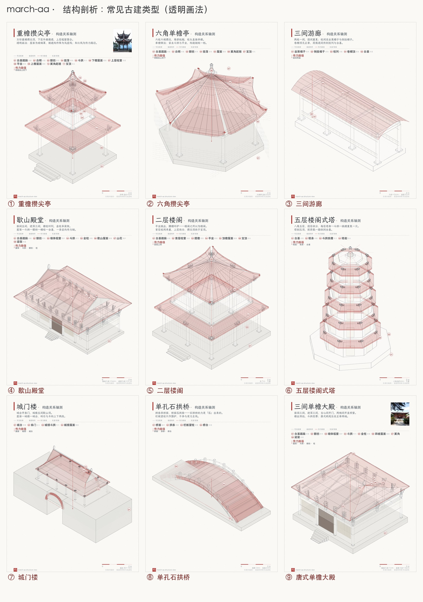

<p align="center">
  
</p>

<p align="center">
  <b>把中国古建拆成可以画、可以算、可以讲清楚的结构</b><br>
  <sub>一个慢慢长出来的古建技能集合 · 参数化 · 不生成 AI 图</sub>
</p>

---

## 名字

**march-aa** 是我给古建相关技能起的项目名：

- **march** —— 三月，也是「行进、稳步推进」的意思；
- **aa** —— *ancient architecture*，古建。

不追求一次做完，一章一章往下推。

## 技能

| 技能 | 做什么 | 状态 |
|---|---|---|
| [`structure-view`](march-aa-structure-view/) | **透明构造关系图**：把整栋楼当一件透明实体画出来，讲构件怎么搭、力怎么传 | v0.5 |
| `exploded-plate` | **分层爆炸图**：把屋顶、斗拱、柱网一层层拆开，讲每层长什么样 | v1.1 · 待迁入 |

两个技能是姊妹篇：**一个透视看关系，一个拆开看构造**。

## 看一张图

<p align="center">
  
</p>

## 共同的方法

三条对所有技能都成立的约束：

1. **不生成 AI 图**。构件的数量、层数、搭接关系必须可数、可核、可复算——改一个参数就重排，而不是重抽一次。
2. **用制图语言，不用渲染语言**。白模 + 线重分级 + 朱红配额；一张图的信息靠线型分层承载，不靠光影。
3. **术语用古建原名**。额枋、斗拱、挂落、平坐、腰檐、山花、撒头、金柱——不用「屋顶」「柱子」这种泛称顶替标注。

## 快速开始

```bash
cd march-aa-structure-view
pip install -r requirements.txt
python scripts/structure_plate.py --json assets/samples/ting_square_2eave.json --out out/ting.png
```

详见 [structure-view 的 README](march-aa-structure-view/README.md)。

## 路线图

- **0.5**（当前）七类形制可出图、透明画法与版式稳定；四条「画得更准」的账没结（见 `structure-view/CHANGELOG.md`）。
- **0.6** 收掉标注锚点、鸱尾咬合、门窗对位、斗拱连续横带。
- **0.7** `exploded-plate` 迁入本仓，两个技能共用几何层。
- **1.0** 文档、样本、校验齐全，可以给别人用。

## 许可

- 代码：MIT（见 [`LICENSE`](LICENSE)）
- 文档与示例图：CC BY 4.0
- 字体：霞鹜文楷 LXGW WenKai，SIL OFL 1.1

## 致谢

形制判读参照梁思成《清式营造则例》与《营造法式》的术语体系；
画法灵感来自建筑分析图传统——把结构画成可以「看进去」的东西。
