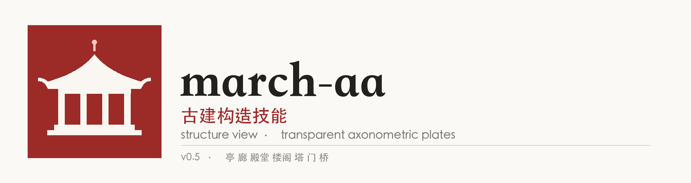
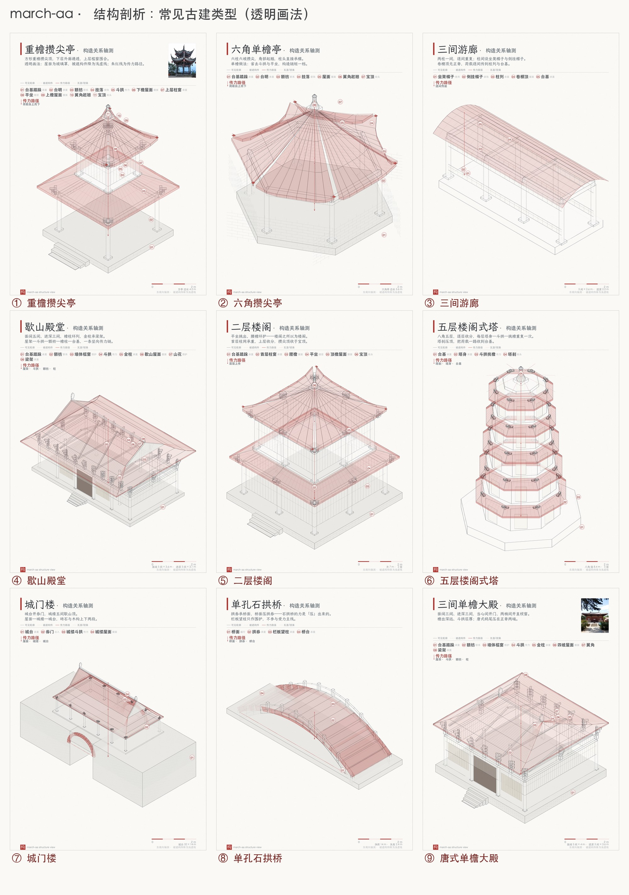
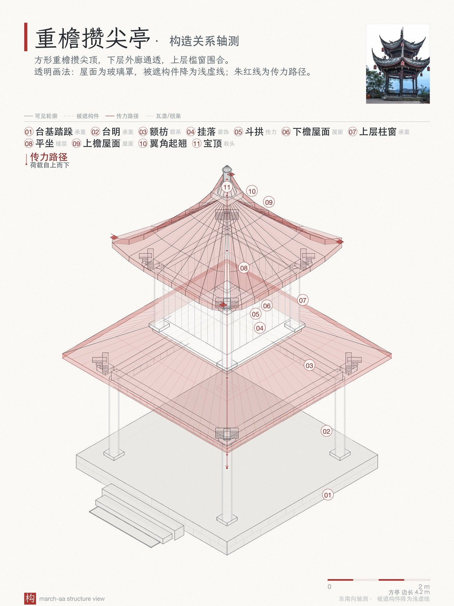
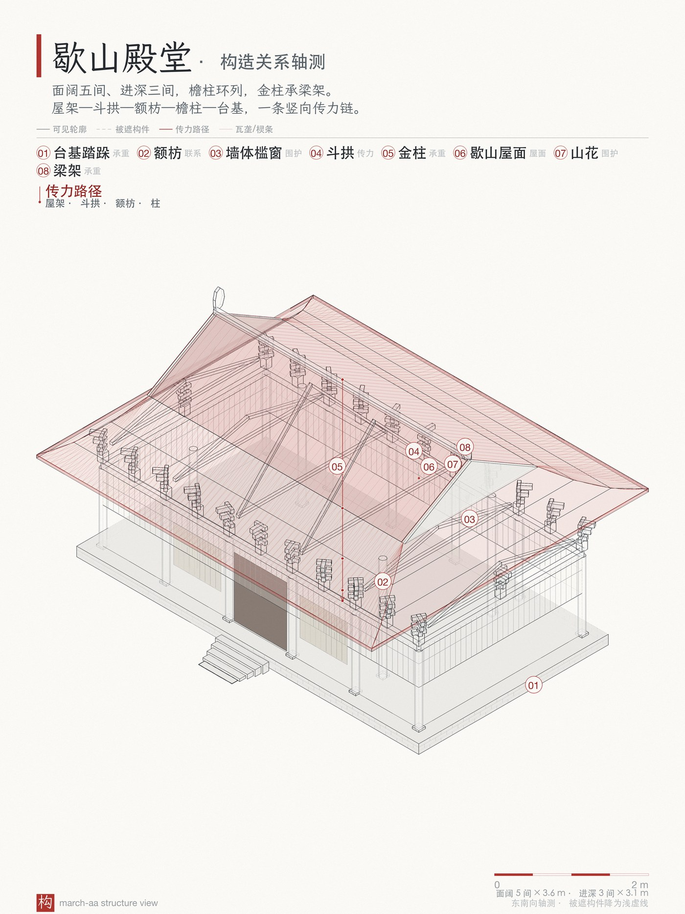
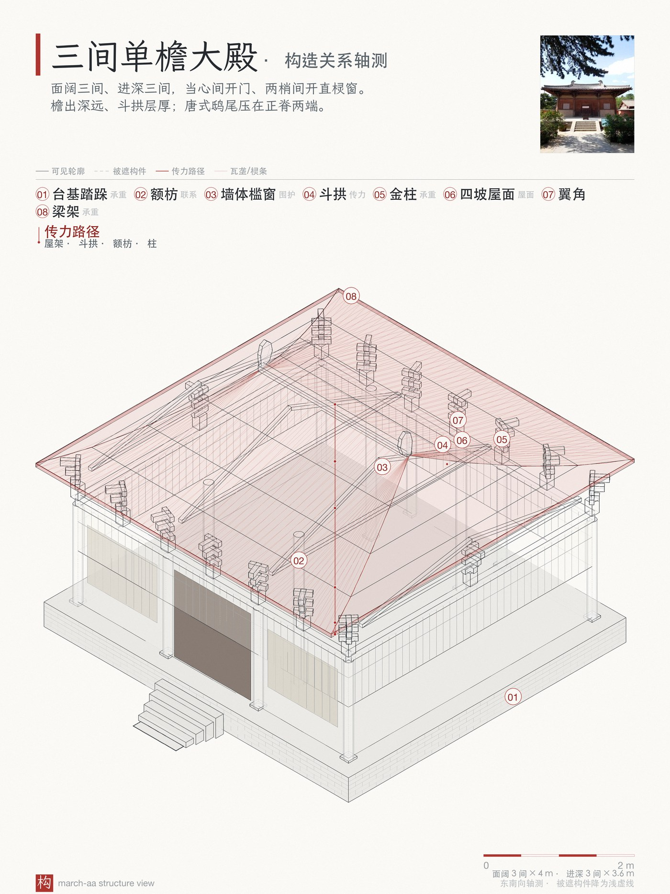
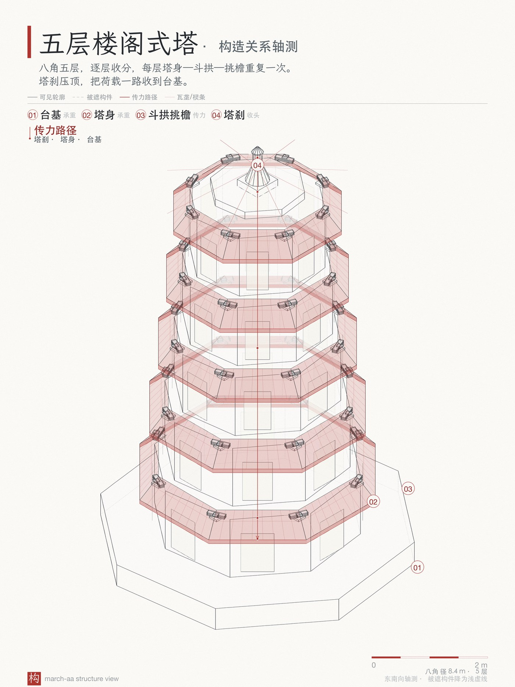
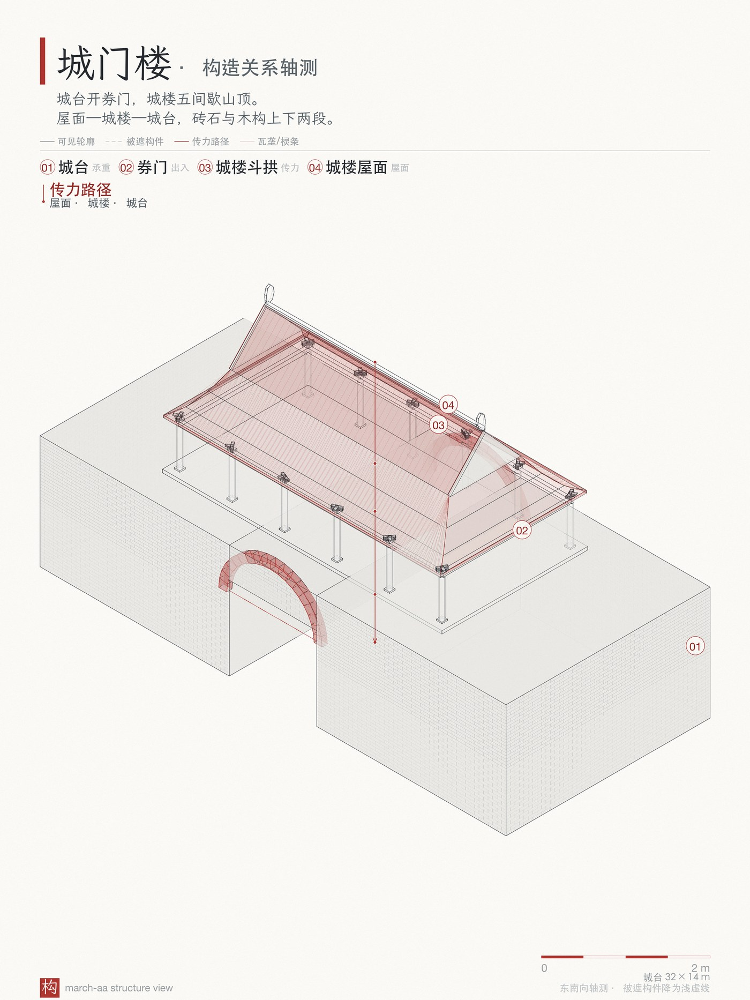
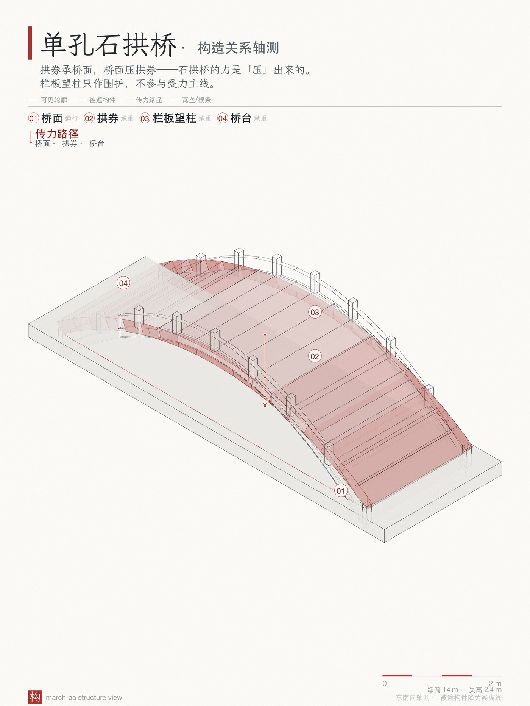

<p align="center">
  
</p>

<p align="center">
  <b>把一张古建照片，变成一张能讲清「它怎么站住」的透明构造图</b><br>
  <sub>v0.5 · 参数化矢量 · 不生成 AI 图 · 覆盖 亭 / 廊 / 殿堂 / 楼阁 / 塔 / 门 / 桥</sub>
</p>

---

## 这是什么

**march-aa** 是我给古建相关技能起的项目名：

- **march** —— 三月，也是「行进、稳步推进」的意思；
- **aa** —— *ancient architecture*，古建。

所以 `march-aa` 是一组**和古建有关的技能包**；`structure view` 是其中的第一个，做的是：

> 把整栋古建当成一件**透明实体**画出来——屋面像玻璃罩，被遮住的构件降为浅虚线，
> 朱红只留给传力链和主轮廓——让读者一眼看懂**构件怎么搭、力怎么传**。

它和我另一个技能 `march-aa-exploded-plate`（分层爆炸图，讲「每层长什么样」）是姊妹篇：
**一个拆开看构造，一个透视看关系。**

<p align="center">
  
</p>

## 几张单张

<p align="center">
  
  
  
</p>
<p align="center">
  
  
  
</p>

## 为什么不用 AI 生图

| | AI 生图 | 本技能 |
|---|---|---|
| 构件 | 随机幻觉，斗拱可能长出六层 | 参数化白名单，层数与构件可数、可核 |
| 复算 | 不可重复 | 同一个 job.json 永远出同一张图 |
| 修改 | 只能重抽 | 改一个参数（`bays: 5 → 3`）就重排 |
| 文字 | 常常是乱码 | 字体直排，中文标注准确 |

立面、剖面、轴测这些**制图语言**本身就有信息密度，参数化能保住这份密度；生成模型保不住。

## 快速开始

```bash
# 需要 numpy + Pillow（系统自带 python3 往往没有）
pip install -r requirements.txt

# 出一条：重檐攒尖亭
python scripts/structure_plate.py \
    --json assets/samples/ting_square_2eave.json \
    --out   out/ting.png
```

输出一行 QA：

```
saved: out/ting.png (2400×3200)  主体 329–2070 × 872–2931  OK
```

> 若 `OK` 变 `WARN`，说明主体压到了标题/照片/页脚，或取景框越界。

### 最小 job

```json
{
  "family": "ting",
  "ratio": "3:4",
  "meta": {
    "title": "重檐攒尖亭",
    "subtitle": "· 构造关系轴测",
    "desc": ["方形重檐攒尖顶，下层外廊通透，上层槛窗围合。",
             "翼角起翘、檐下斗拱层叠，四戗脊收于宝顶。"]
  },
  "params": {"side": 4.2, "eaves": 2, "brackets": true, "finial": true}
}
```

## 从一张照片开始

这是本技能的主用法。核心分工：**测量归脚本，判断归人**——脚本不知道什么是歇山，也不会替你猜间数。

```
拍摄  →  矫正  →  量四条线  →  换算比例  →  认形制  →  出图  →  回照片复核
        （脚本）    （脚本）     （脚本）     （人）
```

### 0. 先要一张能测的照片

比例是从**立面**上量的，拍摄方式直接决定误差。开工前先看这四条，不满足就请用户重拍或换一张：

| 要求 | 为什么 |
|---|---|
| **正对立面**，相机高度约在建筑半高处 | 仰拍会把檐口投影压低、台基拉薄，柱高与斗拱全错 |
| **地平线水平**（台基/地面线在取景框里是平的） | 歪 1° 时，一条横贯画面的线两端能差 ~13 px；斗拱带只有 43 px 高 |
| **中长焦**（等效 50–85mm），离远一点 | 广角会把两端拉斜，透视比倾斜更难救 |
| **建筑占满画面 60% 以上** | 树、天空、游人会污染检测窗口，正脊常常因此漏检 |

另外：**瓦垄纹理很强的屋面，脊线往往检不出来**——正脊一般要人眼补一个 y 值。

### 1. 矫正（默认开）

```bash
# roll：自动拉平。取台基与檐口两条线的拟合角中位数，旋转图片。
python scripts/analyze_photo.py --photo hall.jpg --rectify roll --mark /tmp/bands.png

# quad：四点透视。人手给一个「真实矩形」的四个角（归一化 TL,TR,BR,BL）
python scripts/analyze_photo.py --photo hall.jpg --rectify quad \
    --quad 0.115,0.542,0.885,0.542,0.885,0.703,0.115,0.703 --mark /tmp/bands.png
```

`roll` 便宜且安全，够用于大多数正拍的照片；`quad` 更准，但需要你确认四个角确实在**同一个竖直平面**上
（台明前立面、门洞、匾额都行）。报告里会写 `measure.rectified: {mode, angle_deg | quad}`，便于回溯。

> 注意：**矫正本身不会改变比值**。如果四条线还是从原图人工读的 y，旋转只重采样像素。
> 必须「矫正 → 在矫正后的图上测线 → 再算比值」，这条链才算走完。

### 2. 量四条线

`--mark` 会把候选水平线画回照片并编号，人眼挑出这四条（从下到上）：

```
台基上沿  →  柱顶（斗拱下沿）  →  檐口下沿  →  正脊
```

然后二选一传进去：

```bash
# 给候选线序号
python scripts/analyze_photo.py --photo hall.jpg --mark /tmp/bands.png --lines 9,8,6,5
# 或直接给归一化 y（更稳，推荐）
python scripts/analyze_photo.py --photo hall.jpg --lines 0.703,0.542,0.492,0.416 --out draft.json
```

脚本会算出一组比值写进 `draft.json` 的 `measure.ratios`：

```json
{"col_over_total": 0.641, "bracket_over_total": 0.174, "roof_over_total": 0.185,
 "bracket_over_col": 0.272, "roof_over_col": 0.472, "span_px": 0.287}
```

### 3. 换算成参数

以「台基上沿 → 正脊」为 1，三段分别是 **柱 / 斗拱 / 屋面**。取柱高（常用 4.0–4.8 m）后：

```
柱高   = col_over_total    × H
斗拱高 = bracket_over_col  × 柱高      → params.bracket_h
台基高 = 台基上沿到地面的距离（按图估）  → params.plat_h
正脊长 = 脊两端在照片里的宽度 / 面阔    → params.ridge_ratio
```

写进 job 的 `params`，没量的项保留默认并在说明里标「按常规」。

### 4. 能测什么、测不准什么

单条水平线的读数不确定度约 **±10 px**（853 px 高的 1.2%），换到构件上：

| 量 | 相对误差 | 用法 |
|---|---|---|
| 柱高 / 总高 | ±2% | 可给单值 |
| 台基高 / 柱高 | ±5% | 可给单值 |
| 斗拱层高 / 柱高 | **±20%** | 只给区间，如 `0.27–0.31` |
| 正脊长 / 面阔 | ±15%，且系统性偏 | 标「估」 |
| 举高（屋面坡度） | 量不出 | 只能按常规估 |

**误差上限不在倾斜，而在「选的是哪条边」**：同一条线，上沿/下沿/阴影边能差 ±10 px。
所以斗拱别追精确值，给区间更诚实。

### 5. 认形制，出图

```bash
python scripts/structure_plate.py --json draft.json --out out/x.png
```

出图后**回照片对一遍**：檐口层数、开间数、屋顶形式、台基高度。对不上就回去改 `params`。
`references/photo-to-json.md` 里有完整的字段表与常见错判（重檐看成单檐、歇山看成庑殿、抱厦当主体…）。

## 覆盖的类型

| family | 形体 | 关键参数 |
|---|---|---|
| `ting` 亭 | 方 / 六角 / 八角，单檐 / 重檐 | `side` `sides` `eaves` `brackets` |
| `lang` 廊 | 卷棚顶逐间重复 | `bays` `bay` `depth` |
| `dian` 殿堂 | 庑殿 / 歇山 / 硬山 | `bays` `bay` `depth_bays` `style` `col_h` |
| `lou` 楼阁 | 平坐 + 腰檐 + 顶层收分 | `r` `floors` |
| `ta` 塔 | 楼阁式 / 密檐，八角 | `r` `storeys` `密檐` |
| `men` 门 | 城门楼（券门 + 城台） | `bays` `HW` `HD` |
| `qiao` 桥 | 单孔石拱 | `span` `rise` `width` |

## 三条画法法则

1. **可见与被遮必须分开**。可见边 `INK` 实线，被挡的边一律 `INK3` 浅虚线。
   所有线一个粗细，图就变成「没算完隐藏线的线框」。
2. **屋面是玻璃罩**。它透明是为了看见内部的斗拱与梁架，所以它不参与遮挡计算，
   否则下面的构件会被判成「被挡」而全部虚化，构造反而读不出来。
3. **朱红配额**。只给：传力链、构件编号圈、檐口与戗脊这类主轮廓。多一笔就廉价。

## 目录

```
├── SKILL.md                  # 技能说明（AI 读的入口）
├── README.md                 # 你正在看的
├── CHANGELOG.md
├── scripts/
│   ├── structure_plate.py    # 几何 + 画法 + 版式（单文件，无外部依赖除 numpy/Pillow）
│   └── analyze_photo.py      # 照片测量（只量尺，不下结论）
├── references/
│   ├── lessons.md            # 踩坑清单（24 条，按返工次数排序）+ 交付前自检
│   ├── schema.md             # job.json 字段
│   ├── style.md              # 颜色 / 线重 / 字号 / 版式
│   ├── typology.md           # 形制判定
│   ├── photo-to-json.md      # 照片 → 形制 的流程
│   └── families/             # 七类各自的做法与参数
├── assets/
│   ├── samples/              # 9 个可跑的 job.json
│   ├── brand/                # logo（svg / png）
│   └── fonts/                # 霞鹜文楷（OFL）
└── out/                      # 示例成图
```

## 现在做到哪了（v0.5）

**能用的**：七类形制都能出图；轴测与正立面两种视角；构件编号 + 作用注 + 传力链 + 画法图例 +
比例尺 + 尺寸注记；4 种画幅（3:4 / 1:1 / 4:3 / 9:16）；照片→形制的前五步。

**还差的**（写在 `CHANGELOG.md`）：

- 梁架标注的锚点仍是估算值，应从屋架返回真实杆件坐标；
- 鸱尾鳍根与脊身没有完全咬合；
- 门与踏道在轴测视角里还没精确落在可见面正中；
- 斗拱的三跳横拱尚未连成连续横带。

## 关于 march-aa

一个慢慢长出来的古建技能集合。名字里的 march 是三月，也是「行进」——
不追求一次做完，一章一章往下推。

| 技能 | 做什么 | 状态 |
|---|---|---|
| `march-aa-structure-view` | 透明构造关系图（本仓库） | v0.5 |
| `march-aa-exploded-plate` | 分层爆炸图 | v1.1 |

## 许可

- 代码：MIT（见 `LICENSE`）
- 文档与示例图：CC BY 4.0
- 字体：霞鹜文楷 LXGW WenKai，SIL OFL 1.1（见 `assets/fonts/LICENSE-LXGWWenKai.txt`）

> `assets/fonts/LXGWWenKai-Regular.ttf` 有 18MB。不想把字体放进仓库的话：
> `git rm --cached assets/fonts/*.ttf`，脚本会自动回退到系统字体（Mac 苹方/宋体、Windows 微软雅黑、
> Linux Noto），效果略差但不会报错。

## 致谢

形制判读参照梁思成《清式营造则例》与《营造法式》的术语体系；
画法灵感来自建筑分析图传统——把结构画成可以「看进去」的东西。
